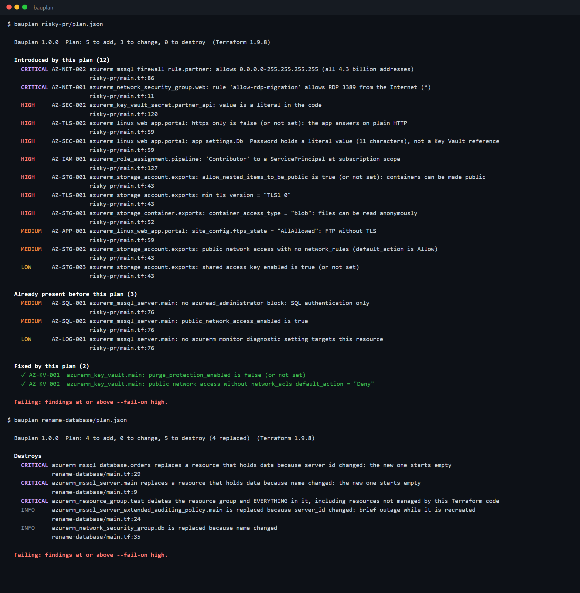
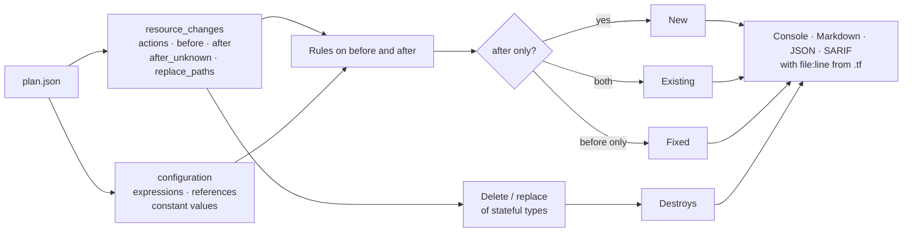

# Bauplan

**Security review of Terraform plans for Azure. Bauplan reads `terraform show -json` and tells a pull request reviewer three things:
what this change destroys, which security problems it introduces, and which it fixes. Misconfigurations that were already there
are listed separately, so a team can start using it on an existing environment without a wall of red.**



> 🇩🇪 **Kurzbeschreibung:** Bauplan prüft einen Terraform-Plan für Azure vor dem `apply`: offene RDP-/SSH- und Datenbankports,
> Datenbank-Firewalls für das ganze Internet, öffentliche Storage-Container, TLS 1.0, Klartext-Secrets in App Settings und im Code,
> Owner/Contributor auf Subscription-Ebene, fehlende Audit-Logs. Vor allem aber erkennt Bauplan, was die Änderung **zerstört**: Eine
> umbenannte SQL-Datenbank wird gelöscht und leer neu angelegt, und Bauplan nennt das Attribut, das den Austausch erzwingt.
> Ergebnisse als Konsole, Markdown für den Pull Request, JSON und SARIF (mit Datei und Zeile im Terraform-Code).

---

## Why a plan, not just the code

Static IaC scanners (tfsec, Checkov) read `.tf` files. That catches a lot, but the code alone cannot tell you:

- **What this change does.** Renaming an `azurerm_mssql_server` looks like a one-word diff. Terraform cannot rename a server, so the plan
  destroys it with every database on it and creates an empty one. The plan JSON says so (`actions: ["delete","create"]`) and even names the
  attribute that forces the replacement (`replace_paths: [["name"]]`). Bauplan turns that into a critical finding, as it does for a resource
  group that is deleted (taking resources nobody put in Terraform with it).
- **New versus existing.** The plan has every resource's state before and after, so Bauplan compares both: a rule that fails *after* but not
  *before* was introduced by this pull request. `--new-only` fails the build only on those (and always on destruction).
- **Fixes.** A pull request that turns on Key Vault purge protection gets credit: "Fixed by this plan".
- **Defaults and computed values.** The plan shows what the provider will actually set (`allow_nested_items_to_be_public = true` when it is
  not written down), and marks values that are only known after apply, which Bauplan then does not guess about.

## Quick start

```bash
git clone https://github.com/karicamar/bauplan && cd bauplan
dotnet run --project src/Bauplan.Cli -- samples/risky-pr/plan.json          # a pull request full of problems
dotnet run --project src/Bauplan.Cli -- samples/rename-database/plan.json   # a "cleanup" that deletes the database
dotnet run --project src/Bauplan.Cli -- samples/hardened/plan.json          # clean
```

With your own code:

```bash
terraform plan -out plan.tfplan
terraform show -json plan.tfplan > plan.json
bauplan plan.json --source . --format markdown -o review.md
```

```text
Usage:
  bauplan <plan.json> [options]
  bauplan rules                                   List the checks

Options:
  -f, --format <console|json|markdown|sarif>     Output format (default: console)
  -o, --output <file>                            Write the report to a file
  -s, --source <folder>                          Terraform code, to point findings at file:line (default: the plan's folder)
      --fail-on <critical|high|medium|low|none>  Exit code 1 at this severity or above (default: high)
      --new-only                                 Fail only on findings this plan introduces (and on destruction)
      --ignore-file <file>                       Accepted risks (default: .bauplan-ignore in the source folder)

Exit codes: 0 = OK, 1 = findings at or above --fail-on, 2 = error.
```

## Checks

| Id | Finds | Severity |
|---|---|---|
| `DESTROY` | Delete or replace of a resource that holds data (databases, storage, Key Vault, disks, backup vaults, DNS zones, ...) or of a resource group, with the attribute that forces it | critical |
| `AZ-NET-001` | NSG rule allowing SSH, RDP, WinRM, SMB, Telnet, the Docker API or database ports (or all ports) from the Internet, also inside port ranges like `20-25` | critical / high |
| `AZ-NET-002` | Database firewall rule over a huge range (`0.0.0.0-255.255.255.255`), or "Allow Azure services" (`0.0.0.0`), which admits every Azure tenant | critical / medium |
| `AZ-STG-001` | Storage account that allows public containers (azurerm 3.x default), container with anonymous `blob`/`container` access | high |
| `AZ-TLS-001` | TLS 1.0/1.1 allowed: storage, SQL, Redis, Event Hubs, Service Bus, App Service, Functions | high |
| `AZ-TLS-002` | App Service without `https_only` (the provider default is false), storage without HTTPS-only, Redis non-TLS port | high |
| `AZ-SEC-001` | App setting or connection string that holds a password, key or token as a literal instead of a Key Vault reference (the value is never printed) | high |
| `AZ-SEC-002` | Password or secret written as a literal in the `.tf` code (from the plan's `configuration` section) | high |
| `AZ-IAM-001` | Owner, Contributor or User Access Administrator at subscription or management group scope, also when the scope is only known after apply but references `data.azurerm_subscription` | high |
| `AZ-AKS-001` | AKS without Kubernetes RBAC, public API server without authorized IP ranges, local admin account | high / medium / low |
| `AZ-STG-002` | Storage account open to all networks (no `network_rules` deny, no separate `azurerm_storage_account_network_rules`) | medium |
| `AZ-KV-001` | Key Vault without purge protection | medium |
| `AZ-KV-002` | Key Vault open to all networks | medium |
| `AZ-SQL-001` | SQL Server without an Entra ID administrator, or with SQL logins still allowed | medium / low |
| `AZ-SQL-002` | SQL, PostgreSQL/MySQL flexible server or Cosmos DB with public network access | medium |
| `AZ-APP-001` | App Service with plain FTP or remote debugging | medium |
| `AZ-VM-001` | Linux VM or scale set with password SSH login | medium |
| `AZ-STG-003` | Storage account that accepts shared access keys | low |
| `AZ-LOG-001` | Key Vault or SQL Server that no diagnostic setting or auditing policy points to (found through the configuration's references) | low |

Each rule has a reason and a concrete fix (`bauplan rules`, the Markdown report, SARIF help), and where one fits a control of the
Microsoft cloud security benchmark. Attribute names cover azurerm 4.x and the older 3.x names.

## In a pull request

```yaml
- run: terraform plan -out plan.tfplan && terraform show -json plan.tfplan > plan.json
- run: bauplan plan.json --new-only --format markdown -o review.md   # post review.md as a PR comment
- run: bauplan plan.json --new-only --format sarif -o bauplan.sarif
- uses: github/codeql-action/upload-sarif@v4
  with:
    sarif_file: bauplan.sarif
```

The Markdown report is written for the reviewer: "Destroys", "Introduced by this plan", "Fixed by this plan", and the existing findings
folded away ([example](docs/example-pr-comment.md), [destruction example](docs/example-destroy.md)). SARIF results point at the `resource`
block in the `.tf` file (Bauplan finds it with `--source`), so GitHub shows them as annotations on the changed lines
([example](docs/example.sarif)). Inside GitHub Actions the Markdown also goes to the run's summary page.

**The plan JSON is a secret.** It contains every value Terraform knows, sensitive ones included (that is how Bauplan can tell that
`Db__Password` is a literal). Do not upload it as a build artifact. Bauplan never prints the values of secrets, only that there is one and
its length; the tests check that none of the sample secrets appears in any report.

Accepted risks go into `.bauplan-ignore`, each with a reason and optionally an expiry date. Destruction has to be accepted explicitly
with `DESTROY`, a `*` does not cover it:

```text
azurerm_storage_account.website    AZ-STG-001   reason="static website, public by design"
module.legacy.*                    *            reason="migration ticket OPS-412" expires=2027-03-31
azurerm_mssql_database.reporting   DESTROY      reason="rebuilt nightly from the warehouse"
```

## How it works



- **Blocks are arrays.** In the plan JSON `site_config { ... }` is `"site_config": [{ ... }]`; attribute paths like
  `site_config.minimum_tls_version` step into the block. Repeated blocks (`security_rule`) are checked one by one, and each problem has a key
  (the rule name), so "RDP rule added to an NSG that already had an open SSH rule" reports the RDP rule as new and the SSH rule as existing.
- **Unknown values.** If `after_unknown` marks an attribute, Bauplan does not judge it from the plan. For role assignments it looks at the
  expression instead: a scope that references `data.azurerm_subscription.current.id` is a subscription scope.
- **Literals.** `configuration` keeps the expressions. An attribute with a `constant_value` (or, for sensitive literals, an expression
  without any reference) is hard-coded; one that references `var.x` or `random_password.y.result` is not.
- **Cross-resource rules.** Diagnostic settings and separate network rule resources point to their target through references, so
  `AZ-LOG-001` and `AZ-STG-002` follow those references instead of guessing by name.

## Testing against the real provider

A real azurerm plan needs an Azure subscription to run `terraform plan`, so the sample `plan.json` files are produced by
[samples/make-plans.mjs](samples/make-plans.mjs) in the documented JSON output format (format_version 1.2). To make sure they describe real
Terraform:

- The sample `.tf` files pass `terraform validate` against the azurerm provider (4.x), in CI.
- [tools/check-provider-schema.mjs](tools/check-provider-schema.mjs) reads `terraform providers schema -json` and checks that every attribute
  the rules use exists for its resource type. It runs weekly against the newest 4.x provider, so a rename like
  `enable_https_traffic_only` → `https_traffic_only_enabled` (azurerm 4.0) breaks the build instead of silently disabling a rule.
  Last local run: azurerm v4.81.0, 29 resource types, all attributes present.
- 145 xUnit tests cover parsing (actions, replace paths, state files and wrong formats rejected), every rule with positive and negative cases,
  new/existing/fixed classification, destruction, ignore entries and expiry, source locations, and the reports.

## Limitations

- Azure (azurerm) only. The plan model is provider-neutral, the rules are not.
- Rules judge single resources plus explicit references. Effective network exposure (NSG on the subnet plus the NIC, route tables,
  Azure Firewall) is not computed.
- Modules: findings and destruction work for resources inside modules (addresses like `module.app.azurerm_x.y`); source locations pick the
  first matching block if a module is used more than once.

## Project layout

```text
src/Bauplan.Core/
  Plan/        plan JSON model (resource_changes, configuration), attribute access with blocks and unknown values
  Rules/       18 Azure rules
  Analysis/    new / existing / fixed, destructive changes, source locations (.tf file and line)
  Policy/      .bauplan-ignore (address globs, DESTROY, reasons, expiry)
  Reporting/   JSON, Markdown for pull requests, SARIF 2.1.0
src/Bauplan.Cli/       the bauplan command
tests/Bauplan.Tests/   145 xUnit tests
samples/               risky-pr, rename-database, hardened: Terraform code + plan.json each
tools/                 provider schema contract check
```

## License

MIT
